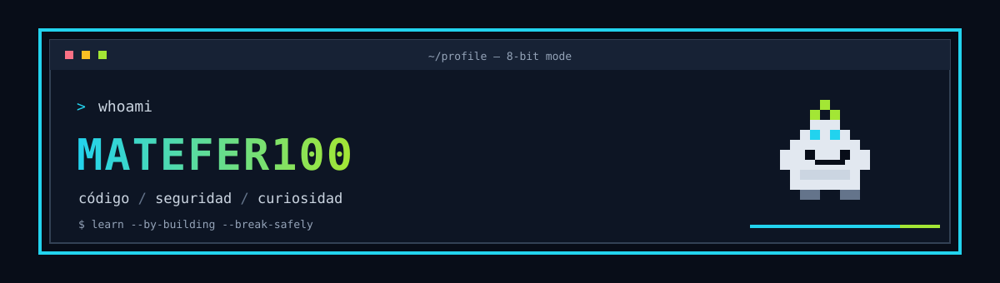

<div align="center">



### Construyo, rompo en entornos seguros y aprendo cómo proteger mejor.

`AppSec` · `desarrollo web` · `aprendizaje práctico`

[](https://github.com/Matefer100)
[](https://github.com/Matefer100/www-project-pygoat)

</div>

---

## 👋 Hola, soy Matefer

Me interesa el cruce entre desarrollo y ciberseguridad: entender cómo funcionan las aplicaciones, encontrar fallos en laboratorios y aprender a corregirlos.

## 🧰 En mi radar


## 🕹️ Proyectos

| 🧪 **EWatch** | 🛰️ **NTIA** | 🐐 **PyGoat** |
|:--|:--|:--|
| Proyecto en desarrollo. | Proyecto en desarrollo. | [Laboratorio educativo de seguridad web](https://github.com/Matefer100/www-project-pygoat). |

### 🐐 PyGoat · `LAB / APPSEC`

Una página informativa de PyGoat, una aplicación educativa para practicar vulnerabilidades web y entender cómo corregirlas. El material describe Python, Django y temas como XSS y SQL injection.

> Aprender seguridad también es aprender a arreglar lo que encuentras. 🛠️

## 📊 Mi actividad en GitHub

<div align="center">


</div>

<details>
<summary>🥚 Un dato muy importante</summary>

```text
bugs encontrados: experiencia ganada
bugs corregidos: experiencia doble
```

</details>

<div align="center">

### `stay curious();` ☕

</div>
